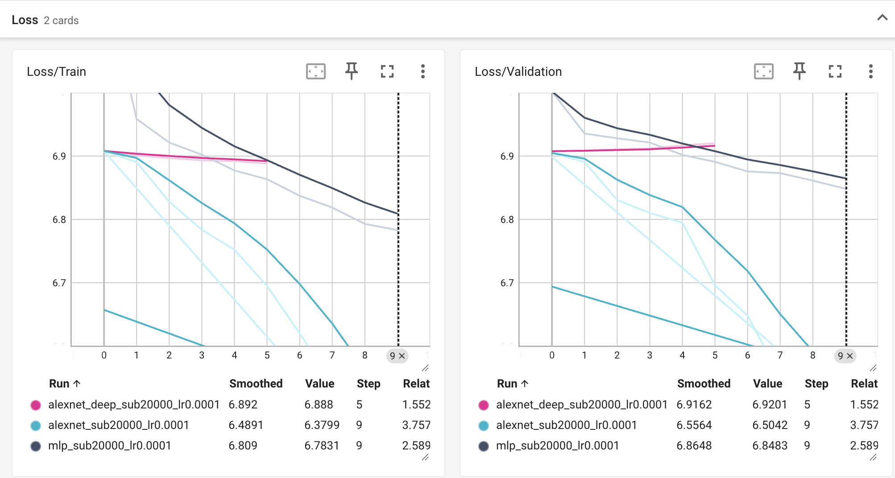
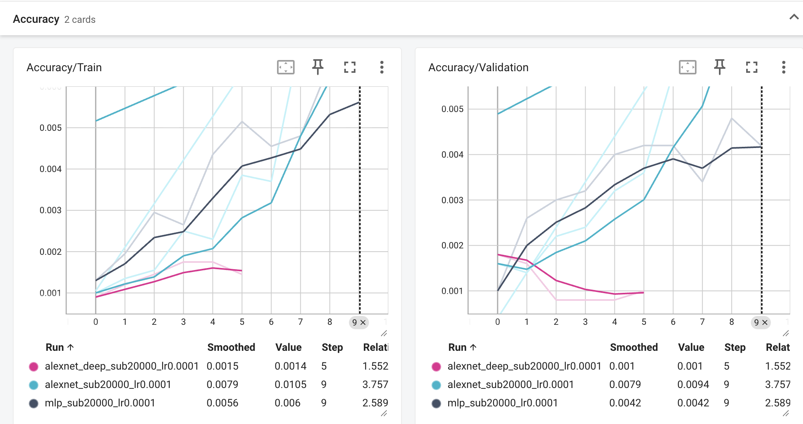

## Ex1

### 1.1
Sans normalisation, les canaux n'ont pas la même échelle. Les mises à jour ($-\eta\nabla L$) peuvent être mal équilibrées et ralentir la descente. On calcule la moyenne et l'écart-type sur le train pour éviter une fuite de données.

### 1.2
Train : crop et flip aléatoires pour varier les images.  
Validation : resize et crop centré pour comparer les résultats.

### 1.3
Flèche gauche ou droite : le flip change la classe.

## Ex2

### 2.1 MLP
Sans biais : $154587\times256+256\times256+256\times1000=39\,895\,808$.  
Avec biais : $39\,895\,808+256+256+1000=39\,897\,320$.  
La première couche contient 99,19 % des paramètres.

Après `flatten`, le MLP ne traite pas les pixels voisins comme un CNN.

### 2.2 AlexNet
Taille de sortie : $\lfloor(H+2P-K)/S\rfloor+1$.  
Paramètres d'une convolution : $(C_{entrée}K^2+1)C_{sortie}$.  
Mémoire : $4CHW/1024$ KB par image.

| Couche | Entrée | Hyperparamètres | Sortie | Paramètres avec biais | Mémoire sortie (KB) |
|---|---|---|---|---:|---:|
| Conv1 + ReLU | 3 × 227 × 227 | 64, K=11, S=4, P=2 | 64 × 56 × 56 | 23 296 | 784 |
| MaxPool1 | 64 × 56 × 56 | K=3, S=2, P=0 | 64 × 27 × 27 | 0 | 182,25 |
| Conv2 + ReLU | 64 × 27 × 27 | 192, K=5, S=1, P=2 | 192 × 27 × 27 | 307 392 | 546,75 |
| MaxPool2 | 192 × 27 × 27 | K=3, S=2, P=0 | 192 × 13 × 13 | 0 | 126,75 |
| Conv3 + ReLU | 192 × 13 × 13 | 384, K=3, S=1, P=1 | 384 × 13 × 13 | 663 936 | 253,50 |
| Conv4 + ReLU | 384 × 13 × 13 | 256, K=3, S=1, P=1 | 256 × 13 × 13 | 884 992 | 169 |
| Conv5 + ReLU | 256 × 13 × 13 | 256, K=3, S=1, P=1 | 256 × 13 × 13 | 590 080 | 169 |
| MaxPool3 | 256 × 13 × 13 | K=3, S=2, P=0 | 256 × 6 × 6 | 0 | 36 |
| Flatten + Dropout | 256 × 6 × 6 | p=0,5 | 9216 | 0 | 36 |
| Linear1 + ReLU + Dropout | 9216 | 4096, p=0,5 | 4096 | 37 752 832 | 16 |
| Linear2 + ReLU | 4096 | 4096 | 4096 | 16 781 312 | 16 |
| Linear3 | 4096 | 1000 | 1000 | 4 097 000 | 3,90625 |

Total : 61 100 840 paramètres et 2339,16 KB par image.

Les paramètres sont surtout dans les couches denses. Les plus grandes activations sont dans les premières convolutions.

MLP : $(256+256+1000)\times4/1024=5,91$ KB par image. AlexNet utilise les mêmes poids à plusieurs positions, donc il produit plus d'activations.

## Ex3

### 3.1
`train()` active le Dropout, `eval()` le désactive. Sans `eval()`, les résultats de validation peuvent changer.

### 3.2
Au hasard : accuracy = 0,1 %, loss = $\ln(1000)\approx6,908$.  
Époque 1 (loss / accuracy) : AlexNet 6,9080 / 0,10 %, MLP 7,1820 / 0,13 %. Le début est proche du hasard.

### 3.3
Résultats après 10 époques sur 20 000 images :

| Modèle | Loss/Train | Loss/Validation | Accuracy/Train | Accuracy/Validation |
|---|---:|---:|---:|---:|
| MLP | 6,7831 | 6,8483 | 0,60 % | 0,42 % |
| AlexNet | 6,3799 | 6,5042 | 1,06 % | 0,94 % |

AlexNet apprend mieux. La loss de validation baisse pour les deux modèles, donc pas de signe clair d'overfitting.

### 3.4
AlexNet profond : 62 871 080 paramètres. Arrêt à l'époque 6 après 5 époques sans progrès en validation.

Loss train / validation : 6,8880 / 6,9201.  
Accuracy train / validation : 0,14 % / 0,10 %.

Le train reste proche du hasard : c'est plutôt de l'underfitting. Les couches en plus peuvent rendre le gradient plus faible.

## Ex4

### 4.1
GPU : NVIDIA L4.  
Première époque : 23 min 22 s. Moyenne : 23 min 13 s (train seul).  
100 époques : environ 38,7 h, sans validation ni Early Stopping.

### 4.2
| Époque | Loss/Train | Loss/Validation | Accuracy/Train | Accuracy/Validation |
|---|---:|---:|---:|---:|
| 1 | 5,6789 | 4,7135 | 4,44 % | 11,29 % |
| 2 | 4,7238 | 4,0857 | 12,12 % | 18,96 % |
| 3 | 4,2991 | 3,7425 | 17,21 % | 23,90 % |
| 4 | 4,0246 | 3,4613 | 20,91 % | 28,36 % |
| 5 | 3,8227 | 3,2829 | 23,72 % | 30,84 % |
| 6 | 3,6685 | 3,1595 | 25,93 % | 33,13 % |
| 7 | 3,5480 | 3,0308 | 27,73 % | 35,21 % |
| 8 | 3,4504 | 2,9501 | 29,21 % | 36,42 % |
| 9 | 3,3666 | 2,8777 | 30,50 % | 37,84 % |

Limite de 4 h atteinte à l'époque 10.

Écart loss validation − train : +0,1243 sur 20 000 images (époque 10), −0,4889 sur ImageNet complet (époque 9). Pas de signe clair d'overfitting. Avec plus d'images et l'augmentation, le modèle mémorise moins facilement.

### 4.3
La loss de validation peut être plus basse : pas de Dropout ni d'augmentation aléatoire.
