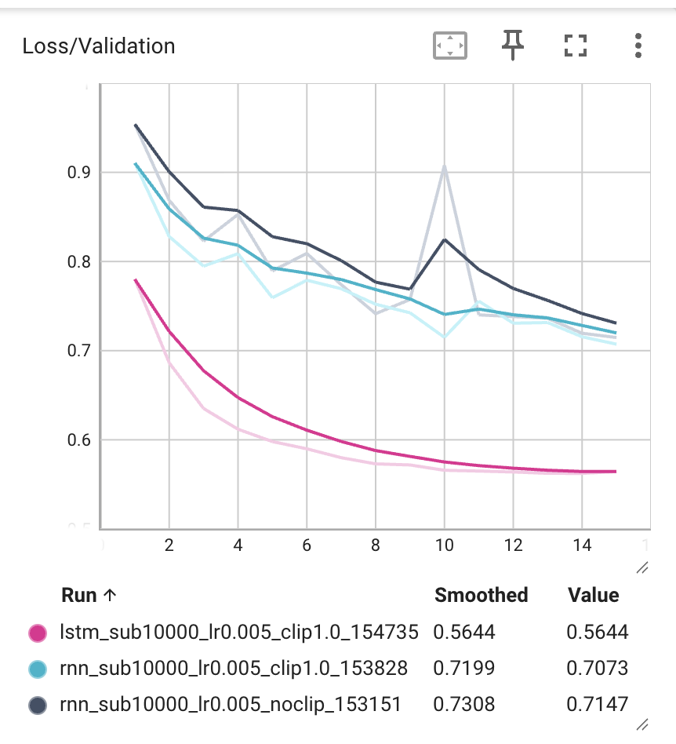
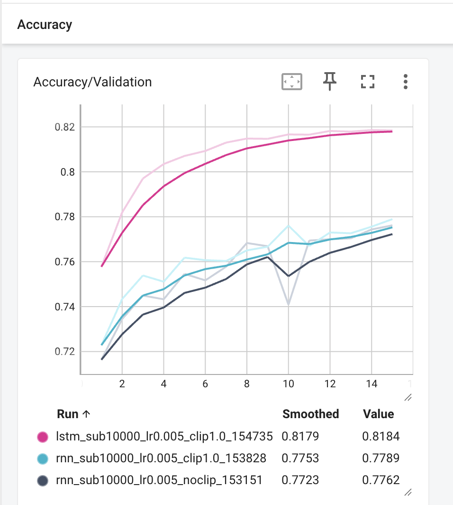
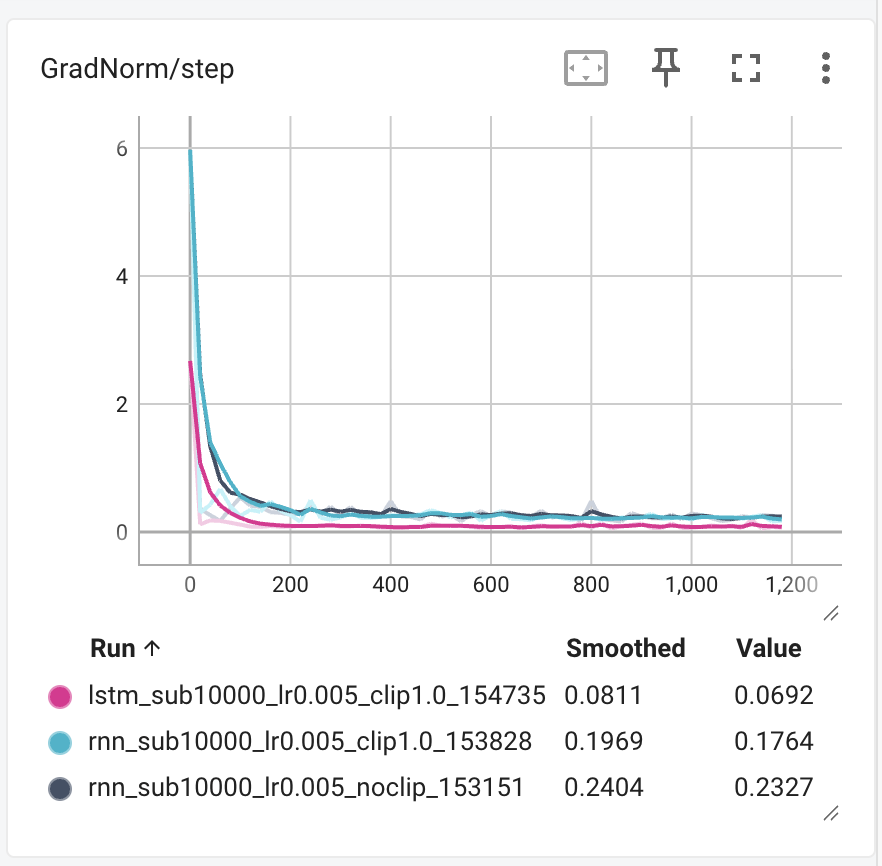

# TP4

## Ex 1

### 1.1 Chargement des données

Train : 214 122 partitions. Validation : 2 162 partitions.

Première partition :

```abc
X:1
L:1/8
M:4/4
K:Emin
|: E2 EF E2 EF | DEFG AFDF | E2 EF E2 B2 |1 efe^d e2 e2 :|2 efe^d e3 B |: e2 ef g2 fe | 
 defg afdf |1 e2 ef g2 fe | efe^d e3 B :|2 g2 bg f2 af | efe^d e2 e2 ||
```

`X` : numéro ; `L` : durée par défaut (1/8) ; `M` : mesure (4/4) ; `K` : tonalité (mi mineur).

L’exemple est très agréable à écouter.

### 1.2 Vocabulaire et padding

95 caractères. Longueur moyenne : 290,1. Longueur maximale : 2 968.

`sorted` garde les mêmes indices à chaque exécution. Sans tri, les poids chargés peuvent correspondre aux mauvais caractères.

Avec 500 caractères, on utilise moins de temps et de mémoire et le modèle apprend moins d’espaces. Les partitions longues sont coupées.

## Ex 2

### 2.1 Dataset

`x = seq[:-1]`, `y = seq[1:]` : prédire le caractère suivant.

Dimensions de `x` et `y` : `(128, 499)` pour un batch complet. `torch.long` : indices entiers pour l’embedding et la loss.

### 2.2 RNN et LSTM

V = 95, E = 256, H = 512.

- Embedding : V × E = 24 320.
- RNN : H × E + H × H + 2H = 394 240.
- LSTM : 4 × 394 240 = 1 576 960 (entrée, oubli, sortie et candidat).
- Sortie : H × V + V = 48 735.

Total RNN : 467 295. Total LSTM : 1 650 015. À vérifier avec `count_parameters`.

Embedding : un vecteur par caractère. La valeur de l’indice ne donne pas un ordre entre les caractères.

RNN : `h`. LSTM : `(h, c)`. `h` est l’état caché et `c` garde la mémoire.

## Ex 3

### 3.1 Loss et clipping

Dimensions pour `CrossEntropyLoss` : `(B × 499, V)` et `(B × 499,)`. Avec B = 128, `-1` vaut 63 872.

`backward()` calcule les gradients, le clipping limite leur norme, puis `step()` met à jour les poids.

Early stopping : on garde le modèle avec la meilleure loss de validation. Arrêt après 5 époques sans amélioration.

### 3.2 Résultats après 15 époques

| Run | Configuration | Validation loss | Validation accuracy |
| --- | --- | ---: | ---: |
| 1 | RNN sans clipping | 0,7147 | 77,62 % |
| 2 | RNN, clipping à 1 | 0,7073 | 77,89 % |
| 3 | LSTM, clipping à 1 | 0,5644 | 81,84 % |







Runs 1 et 2 : la validation loss varie moins avec clipping. Sans clipping, elle remonte à 0,9079 à l’époque 10. Les deux RNN ont un pic proche de 6 au début, puis la norme baisse. `GradNorm/step` montre la norme avant clipping.

Runs 2 et 3 : le LSTM a déjà une loss de 0,6864 à l’époque 2, contre 0,7073 pour le RNN à l’époque 15.

`c_t = f_t ⊙ c_(t−1) + i_t ⊙ g_t`. Si `f_t` est proche de 1, le LSTM garde mieux la mémoire et le gradient.

### 3.3 Padding

Les espaces ajoutés sont faciles à prédire, donc l’accuracy augmente. `ignore_index=char_to_index[' ']` enlève tous les espaces du calcul de la loss, même ceux des partitions.

## Ex 4

### 4.1 Génération

Pour N caractères avec une amorce fixe : O(N²) si on recalcule toute la séquence, O(N) si on garde l’état caché.

T → 0 : caractère le plus probable (si le maximum est unique).

T → ∞ : même probabilité pour tous les caractères.

### 4.2 Entraînement long

50 000 partitions, H = 1024, 30 époques max., clipping à 1.

Arrêt à l’époque 20. Meilleur modèle : époque 15, validation loss = 0,4706, accuracy = 84,64 %. On charge ce modèle pour générer 300 caractères par extrait après l’amorce.

### T = 0.2

```abc
X:1
T:Irish Reel
M:4/4
L:1/8
K:D
 A | A2 d dcd efg | f2 d dcd ecA | A2 d dcd efg | fed cBA d2 :| e | f2 d dcd fed | 
 c2 e ecA A2 g | f2 d dcd fed | c2 e ecA A2 :|                                                                                                                                                                          
```

C’est très rigide et ça se répète. Il n’y a rien de nouveau.

### T = 0.8

```abc
X:1
T:Irish Reel
M:4/4
L:1/8
K:D
 A3/2 F/ A/A/ A d2 A | Bcd ABG F2 A | ABA AFA d2 A | (d/e/f)d e2 d cBA |: d2 e f2 d g3 | 
 d2 e f/g/af afd | d2 e f/g/af g2 e | f2 d g/f/ef d2 A :|                                                                                                                                                         
```

C’est un peu désordonné. Je ne l'aime pas.

### T = 2.0

```abc
X:1
T:Irish Reel
M:4/4
L:1/8
K:D
|: D2 E=FED D>G FDdg/f/ | F d2 F C>"A"AF"^Not osmpo..b\#mA" [Edf]3 x :| (f>=ed) BB f[dEe]-2 x/>g9/- [fD] B3 c2- |3-A F(uEF-F E3) C4 B2- Bf |: 
 fC2B AC-D>E B4 F4 (DEGC) .F2^DE | ^GAB,d-dE FGFEBA2<A, A,Bcd :|                                                                                             
```

C’est vraiment trop fou. Je n’arrive pas à apprécier cette musique.

Les trois extraits finissent par des espaces, comme dans les données d’entraînement.
