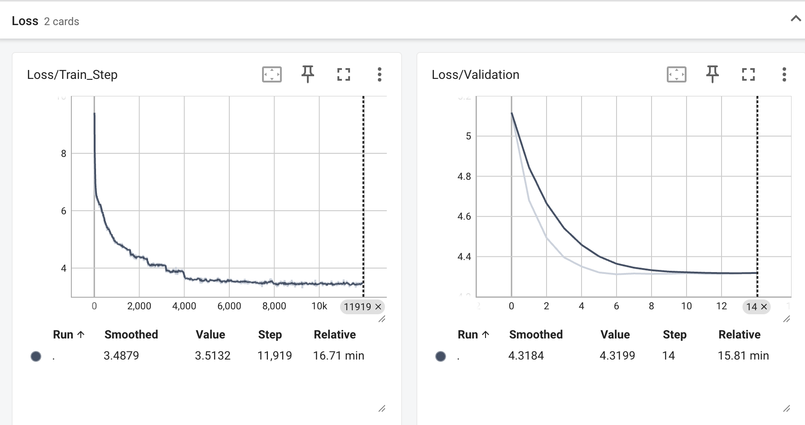
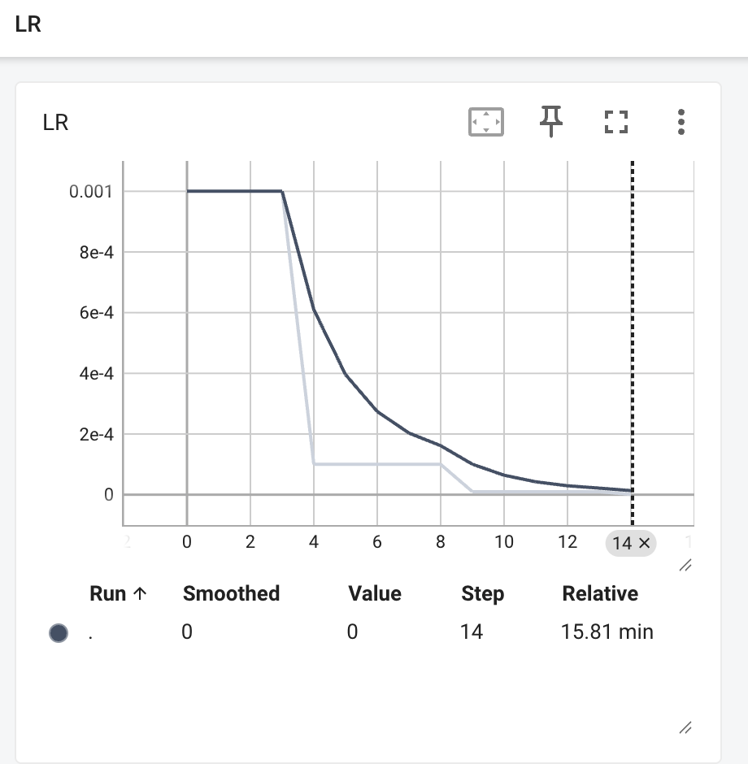

# TP5 — Image Captioning

## Ex1

Images : 224 × 224. Comme ça, les images ont la même taille et on peut les mettre dans un même batch. C’est le format utilisé pour le ResNet pré-entraîné.

Train : 80 %. Test : 20 %.

## Ex2

On gèle les poids du ResNet pour utiliser moins de mémoire et faire moins de calculs. On garde aussi les caractéristiques apprises sur ImageNet, avec moins de risque de surapprentissage.

Entrée : `(32, 3, 224, 224)`  
Sortie : `(32, 2048, 7, 7)` → 49 régions par image.

## Ex3

`context_vector` : somme pondérée des régions de l’image. L’attention peut utiliser ces régions directement, au lieu de résumer toute l’image dans un seul vecteur comme dans le Seq2Seq de base.

## Ex4

### Prédictions

Run 54382, 15 époques.

Époque 1 : « man people are sitting in in the with with people are in in in red the in in on ».

Époque 10 : « two men are standing in in the pool with men are in are in other is wearing in in ».

À l’époque 10, le modèle trouve le mot « pool », mais il ne parle pas de la plongée. Il y a encore des répétitions et des erreurs de grammaire. Les mots précédents de la vraie légende sont donnés au modèle (teacher forcing).

### Loss

La validation loss baisse de 5,12 à 4,32, puis reste presque stable.

### Learning rate

Adam. LR utilisé : 0,001 (époques 1–5), 0,0001 (6–10), 0,00001 (11–15). Le graphe montre le LR après chaque mise à jour de StepLR.

Si on garde 0,001, les poids peuvent encore osciller à la fin. Avec Adam, même avec le momentum et les pas adaptés, baisser le LR rend les mises à jour plus petites.
