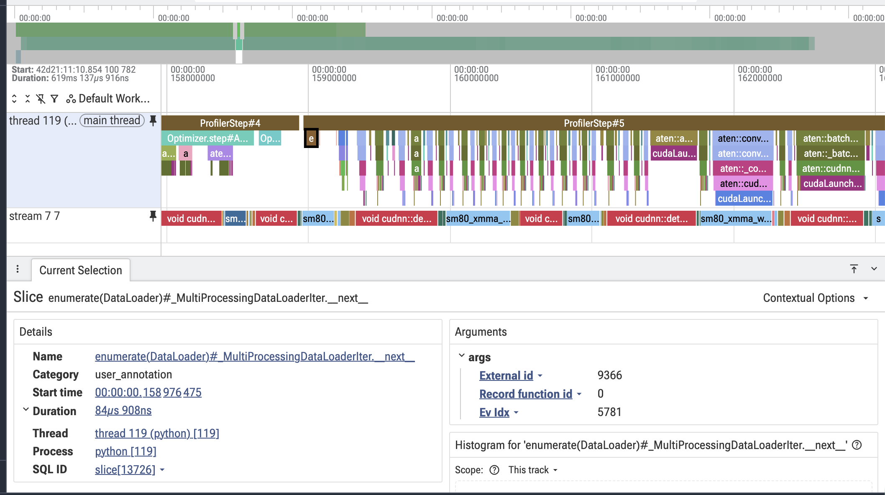
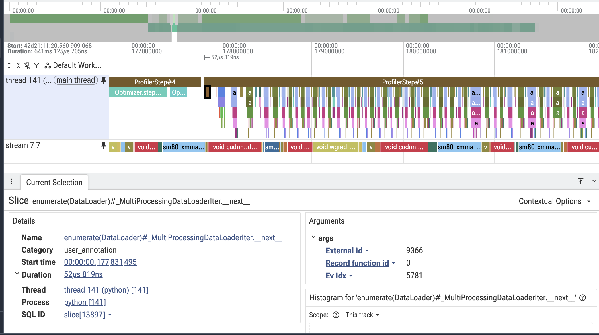

## Ex0

### 0.a

```text
Machine        : arcadia-slurm-node-1
Python         : 3.10.20
torch          : 2.10.0 (CUDA 13.0)
torchvision    : 0.26.0
torchao        : 0.18.0
CPU alloués    : 4  (x86_64)
Drapeaux CPU   : avx512f, avx512_vnni, avx512_bf16
GPU            : NVIDIA H100 NVL
Mémoire GPU    : 95321 Mio au total, 94795 Mio libres
bf16 supporté  : True
```

### 0.b

J’ai eu une H100 entière (environ 93 Gio). Avec 4 CPU, le décodage peut faire attendre le GPU.

## Ex1

### 1.a

| Test | Débit (img/s) | Pic GPU (Go) | Époque (s) |
|---|---:|---:|---:|
| `ref-synth` | 709,0 | 5,95 | — |
| `ref-raw` | 715,9 | 5,95 | 21,7 |

### 1.b

Poids + gradients + états AdamW = 376 Mo. Activations = 64 × 84 = 5 376 Mo.

Total = 5,75 Go. Le pic mesuré est de 5,95 Go. Le calcul utilise aussi des buffers temporaires.

### 1.c

Retour de l’appel Python après 18,0 ms. Fin du calcul GPU après 88,6 ms. `torch.cuda.synchronize()` attend que le GPU finisse.

### 1.d

1 128 images en FP32. Le cours donne environ 120 pour un MIG. La H100 entière a plus de mémoire.

### 1.e

Environ 1 % d’écart. En FP32, trois workers préparent les images assez vite.

## Ex2

### 2.a

| Test | Débit (img/s) |
|---|---:|
| `raw-w0` | 159,3 |
| `raw-w1` | 241,7 |
| `raw-w2` | 623,2 |
| `raw-w3` | 700,4 |
| `raw-w3-nopin` | 623,2 |
| `small-w0` | 275,0 |
| `small-w3` | 696,3 |

### 2.b

Plus de workers, plus d’images par seconde. Le processus principal utilise aussi un CPU. Avec plus de trois workers, plusieurs processus se partagent les CPU.

### 2.c

`pin_memory` facilite la copie asynchrone vers le GPU. Sans cette option, le débit baisse de 11 %.

### 2.d

`small` a moins de pixels à lire et à décoder. Les photos sont les mêmes. Le redimensionnement et le recadrage peuvent changer les pixels.

### 2.e

Temps de préparation par image = `1 / D_w0 − 1 / 709`.

| Données | Temps par image (ms) | 1 worker (img/s) | Limite estimée avec 3 workers (img/s) |
|---|---:|---:|---:|
| `raw` | 4,87 | 205 | 616 |
| `small` | 2,23 | 449 | 1 348 |

### 2.f



`raw-w3` prend 85 µs pour recevoir le lot au pas 5.



`small-w3` prend 53 µs au même pas. Dans les deux cas, le GPU continue ses convolutions sur `stream 7`. La limite principale est le calcul GPU.

### 2.g

700,4 / 709,0 = 98,8 % avec `raw-w3`.

## Ex3

### 3.a

H100 NVL. CL = `channels_last`.

| Mode | Données | Workers | Débit (img/s) | Pic GPU (Go) | Premier pas compilé (s) |
|---|---|---:|---:|---:|---:|
| FP32 | Synthétiques | — | 716,5 | 5,95 | — |
| TF32 | Synthétiques | — | 1 638,9 | 5,94 | — |
| BF16 | Synthétiques | — | 1 985,8 | 3,29 | — |
| BF16 + CL | Synthétiques | — | 2 866,6 | 3,29 | — |
| BF16 + CL + compile | Synthétiques | — | 2 703,2 | 3,17 | 54,5 |
| BF16 + CL | `raw` | 1 | 224,5 | 3,29 | — |
| BF16 + CL + compile | `raw` | 1 | 218,8 | 3,18 | 3,6 |
| BF16 + CL | `raw` | 3 | 2 527,9 | 3,29 | — |
| BF16 + CL + compile | `raw` | 3 | 1 057,9 | 3,18 | 6,6 |
| BF16 + CL | `small` | 1 | 470,9 | 3,29 | — |
| BF16 + CL + compile | `small` | 1 | 504,2 | 3,18 | 3,8 |
| BF16 + CL | `small` | 3 | 1 352,7 | 3,29 | — |
| BF16 + CL + compile | `small` | 3 | 2 420,7 | 3,18 | 5,2 |

### 3.b

(716,5 − 709,0) / 709,0 = 1,06 %. Un écart de 1 % peut venir de la variation entre deux tests.

### 3.c

- TF32 ×2,29 grâce aux Tensor Cores.
- BF16 ×1,21 avec moins de données à lire et à écrire en mémoire.
- `channels_last` ×1,44 grâce à un meilleur accès aux données.
- Compile ×0,94. La fusion peut réduire les lancements de noyaux. Ici, le débit baisse de 5,7 %.

### 3.d

Avec un worker, le débit est proche de l’estimation de l’Ex2. Le GPU attend les images. Avec compile, les résultats vont de 213 à 299 img/s pour `raw` et de 348 à 513 pour `small`. Le gain est faible ou incertain. D’après Amdahl, accélérer le calcul aide peu si le GPU attend les images.

Avec trois workers, `raw` sans compile et `small` avec compile atteignent environ 90 % du débit synthétique. Dans les deux autres cas, on reste sous 50 %. Le chargement peut expliquer une partie de cet écart. L’Ex2 sous-estime certains débits avec trois workers.

### 3.e

Sur la H100 entière, 2 866,6 / 205 ≈ 14 workers pour `raw` et 2 866,6 / 449 ≈ 7 pour `small`, en arrondissant au-dessus. Les 30 cœurs du nœud suffiraient. Le job avait 4 CPU.

### 3.f

Premier appel à 54,5 s, puis de 3,6 à 6,6 s. Le cache explique probablement la baisse.

Je compare le temps total avec et sans compile. Pour `small` à trois workers, il faut environ 248 pas avec le cache ou 2 610 sans cache. À un worker, il faut 410 ou 6 058 pas. Les autres tests ralentissent avec compile. Sur 402 pas, seul `small` à trois workers avec le cache gagne du temps.

### 3.g

2 200 / 1 128 = 1,95. En BF16, les activations prennent environ deux fois moins de place. Les poids et les états AdamW restent en FP32.

### 3.h

J’ai utilisé BF16, `channels_last`, `raw` et trois workers, sans compile.

| Époque (indice du script) | Temps (s) | Débit (img/s) | Top-1 |
|---|---:|---:|---:|
| 0 | 28,0 | 459,3 | 99,4 % |
| 1 | 16,7 | 771,2 | 99,4 % |

La première époque inclut le démarrage des workers et la chauffe du GPU. Sur la deuxième, le gain est de 21,7 / 16,7 = 1,30× par rapport à `ref-raw`.

## Ex4

### 4.a

`Socket` sur `ens18`. All-reduce de 102 Mo en 878 ms. Les deux débits affichés sont de 0,12 Go/s, soit 0,96 Gbit/s. C’est proche du débit d’un lien Ethernet à 1 Gbit/s.

### 4.b

NVIDIA L4 et données synthétiques.

| Test | GPU | Temps (ms) | Débit (img/s) | S | E |
|---|---:|---:|---:|---:|---:|
| All-reduce | 2 | 878,0 | — | — | — |
| `l4-x1` | 1 | 138,6 | 461,7 | 1,00× | — |
| `l4-x2` | 2 | 866,1 | 147,8 | 0,32× | 16,0 % |
| `l4-x2-bf16hook` | 2 | 463,2 | 276,4 | 0,60× | 29,9 % |
| `l4-x1-accum8` | 1 | 1 056,4 | 484,6 | 1,00× | — |
| `l4-x2-accum8-bf16hook` | 2 | 1 378,5 | 742,8 | 1,53× | 76,6 % |

### 4.c

Communication = 878 × 94 / 102 = 809,1 ms.

Sans chevauchement, 138,6 + 809,1 = 947,7 ms. Avec chevauchement complet, 809,1 ms. La mesure est de 866,1 ms. Le calcul masque environ 947,7 − 866,1 = 81,6 ms.

### 4.d

Le hook envoie les gradients en 16 bits. Le pas passe de 866,1 à 463,2 ms. L’arrondi des gradients peut changer l’apprentissage.

### 4.e

Amdahl suppose un travail fixe. Ici, deux GPU traitent plus d’images par pas et s’échangent les gradients.

Estimation = 8 × 138,6 + 809,1 / 2 − 81,6 ≈ 1 432 ms. La mesure est 1 378,5 ms, environ 53 ms de moins.

### 4.f

À accumulation égale, le pas à deux GPU doit prendre moins de deux fois le pas à un GPU. Le hook envoie moins d’octets et arrondit les gradients. L’accumulation réduit les échanges et augmente le batch effectif.

### 4.g

Batch de départ 64, puis 128 et 1 024. AdamW ×√2 puis ×4. SGD ×2 puis ×16, avec un warm-up.

### 4.h

Même graine pour les mêmes poids de départ. Des images différentes sur chaque GPU donnent un batch global plus grand.

Sans `sampler.set_epoch()`, l’ordre des images se répète. Sans `no_sync()`, les gradients sont échangés à chaque micro-batch.

## Ex5

### 5.a

Job 54875 avec `best.pth`, 4 threads et 200 images de calibration pour INT8.

| Variante | Taille (Mo) | Latence (ms) | Premier appel (s) | Top-1 |
|---|---:|---:|---:|---:|
| FP32 eager | 94,3 | 51,33 | 0,1 | 98,2 % |
| FP32 compilé | 94,3 | 27,67 | 33,6 | 98,2 % |
| BF16 compilé | 47,2 | 15,24 | 10,9 | 98,2 % |
| INT8 compilé | 23,9 | 12,24 | 3,7 | 98,2 % |

### 5.b

94,3 / 23,9 = 3,95. Les biais et les échelles ont aussi une taille. `weights_mb` compte les tenseurs utilisés. Le `state_dict` peut garder des poids FP32 qui ne sont plus utilisés.

### 5.c

27,67 / 12,24 = 2,26. On compare deux versions compilées pour mesurer l’effet d’INT8. VNNI peut aider. Aucun drapeau AMX dans le test.

### 5.d

Les deux top-1 sont à 98,2 %, avec quelques prédictions différentes. Avec 200 images, l’accord avec FP32 vaut 99,2 % et l’écart des logits 0,0794. Avec 10 images, 99,6 % et 0,0804. Les images de calibration servent à choisir les plages de valeurs à quantifier.

### 5.e

De 1 à 4 threads, FP32 passe de 89,60 à 27,67 ms (×3,24) et INT8 de 26,13 à 12,24 ms (×2,13). Quatre threads réduisent la latence. Avec un thread, on peut traiter plus de requêtes en parallèle si on a plusieurs cœurs.

### 5.f

La quantification dynamique aide surtout les couches linéaires. Ici, les convolutions font presque tout le calcul.

## Bilan

| Configuration | Matériel | Données | Débit (img/s) | Pic GPU (Go) | Époque (s) |
|---|---|---|---:|---:|---:|
| FP32, `ref-synth` | H100 NVL | Synthétiques | 709,0 | 5,95 | — |
| FP32, `ref-raw` | H100 NVL | `raw`, 3 workers | 715,9 | 5,95 | 21,7 |
| BF16 + CL, meilleur test avec images | H100 NVL | `raw`, 3 workers | 2 527,9 | 3,29 | — |
| BF16 + CL, entraînement (époque 0) | H100 NVL | `raw`, 3 workers | 459,3 | — | 28,0 |
| BF16 + CL, entraînement (époque 1) | H100 NVL | `raw`, 3 workers | 771,2 | — | 16,7 |
| DDP, hook BF16 et accumulation 8 | 2 × L4 | Synthétiques | 742,8 | — | — |
| FP32 compilé | CPU x86, 4 threads | `small` | ≈ 36,1 | — | — |
| INT8 compilé | CPU x86, 4 threads | `small` | ≈ 81,7 | — | — |

Sur deux L4 sans compression, le pas prend 727,5 ms de plus que sur une L4. Les échanges réseau et l’attente entre processus expliquent cet écart. Les lots sont déjà sur les GPU.

Pour deux époques, je prends une H100, BF16, `channels_last` et `raw` avec trois workers, sans compile. La deuxième époque prend 16,7 s contre 21,7 s en FP32. Sur CPU, je prends INT8 compilé à 4 threads. Il prend 12,24 ms par image avec le même top-1 que FP32 compilé.

## Annexe · Tableaux générés par `summarize.py`

Dans `results_quant.csv`, les sept premières lignes de données correspondent au checkpoint de secours et les sept suivantes au job 54875 avec `best.pth`. La section 5 analyse les résultats du job 54875.

### results_bench.csv

| tag | materiel | arch | precision | channels_last | compile | donnees | workers | pin_memory | batch | img_s | img_s_min | img_s_max | pic_memoire_go | compilation_s | epoque_s |
|---|---|---|---|---|---|---|---|---|---|---|---|---|---|---|---|
| ref-synth | NVIDIA H100 NVL | resnet50 | fp32 | False | False | synthetic |  |  | 64 | 709.0 | 708.5 | 711.7 | 5.95 | nan | nan |
| ref-raw | NVIDIA H100 NVL | resnet50 | fp32 | False | False | raw | 3 | True | 64 | 715.9 | 710.6 | 716.5 | 5.95 | nan | 21.7 |
| raw-w0 | NVIDIA H100 NVL | resnet50 | fp32 | False | False | raw | 0 | True | 64 | 159.3 | 154.8 | 163.9 | 5.95 | nan | nan |
| raw-w1 | NVIDIA H100 NVL | resnet50 | fp32 | False | False | raw | 1 | True | 64 | 241.7 | 239.9 | 243.5 | 5.95 | nan | nan |
| raw-w2 | NVIDIA H100 NVL | resnet50 | fp32 | False | False | raw | 2 | True | 64 | 623.2 | 542.2 | 704.1 | 5.95 | nan | nan |
| raw-w3 | NVIDIA H100 NVL | resnet50 | fp32 | False | False | raw | 3 | True | 64 | 700.4 | 698.8 | 702.1 | 5.95 | nan | nan |
| raw-w3-nopin | NVIDIA H100 NVL | resnet50 | fp32 | False | False | raw | 3 | False | 64 | 623.2 | 617.5 | 629.0 | 5.95 | nan | nan |
| small-w0 | NVIDIA H100 NVL | resnet50 | fp32 | False | False | small | 0 | True | 64 | 275.0 | 274.9 | 275.2 | 5.95 | nan | nan |
| small-w3 | NVIDIA H100 NVL | resnet50 | fp32 | False | False | small | 3 | True | 64 | 696.3 | 688.2 | 704.5 | 5.95 | nan | nan |
| fp32-synthetic | NVIDIA H100 NVL | resnet50 | fp32 | False | False | synthetic |  |  | 64 | 716.5 | 713.8 | 717.3 | 5.95 | nan | nan |
| tf32-synthetic | NVIDIA H100 NVL | resnet50 | tf32 | False | False | synthetic |  |  | 64 | 1638.9 | 1617.1 | 1658.7 | 5.94 | nan | nan |
| bf16-synthetic | NVIDIA H100 NVL | resnet50 | bf16 | False | False | synthetic |  |  | 64 | 1985.8 | 1984.2 | 1989.2 | 3.29 | nan | nan |
| bf16-cl-synthetic | NVIDIA H100 NVL | resnet50 | bf16 | True | False | synthetic |  |  | 64 | 2866.6 | 2858.7 | 2890.5 | 3.29 | nan | nan |
| bf16-cl-compile-synthetic | NVIDIA H100 NVL | resnet50 | bf16 | True | True | synthetic |  |  | 64 | 2703.2 | 2692.2 | 2710.1 | 3.17 | 54.5 | nan |
| bf16-cl-raw-w1 | NVIDIA H100 NVL | resnet50 | bf16 | True | False | raw | 1 | True | 64 | 224.5 | 218.0 | 230.6 | 3.29 | nan | nan |
| bf16-cl-compile-raw-w1 | NVIDIA H100 NVL | resnet50 | bf16 | True | True | raw | 1 | True | 64 | 218.8 | 213.4 | 299.1 | 3.18 | 3.6 | nan |
| bf16-cl-raw-w3 | NVIDIA H100 NVL | resnet50 | bf16 | True | False | raw | 3 | True | 64 | 2527.9 | 2190.2 | 2634.3 | 3.29 | nan | nan |
| bf16-cl-compile-raw-w3 | NVIDIA H100 NVL | resnet50 | bf16 | True | True | raw | 3 | True | 64 | 1057.9 | 999.4 | 1403.8 | 3.18 | 6.6 | nan |
| bf16-cl-small-w1 | NVIDIA H100 NVL | resnet50 | bf16 | True | False | small | 1 | True | 64 | 470.9 | 466.1 | 475.0 | 3.29 | nan | nan |
| bf16-cl-compile-small-w1 | NVIDIA H100 NVL | resnet50 | bf16 | True | True | small | 1 | True | 64 | 504.2 | 347.6 | 513.3 | 3.18 | 3.8 | nan |
| bf16-cl-small-w3 | NVIDIA H100 NVL | resnet50 | bf16 | True | False | small | 3 | True | 64 | 1352.7 | 827.1 | 1516.7 | 3.29 | nan | nan |
| bf16-cl-compile-small-w3 | NVIDIA H100 NVL | resnet50 | bf16 | True | True | small | 3 | True | 64 | 2420.7 | 2188.4 | 3157.3 | 3.18 | 5.2 | nan |

### results_ddp.csv

| tag | materiel | processus | noeuds | backend | precision | bf16_hook | donnees | accumulation | batch_par_processus | batch_effectif | pas_ms | img_s |
|---|---|---|---|---|---|---|---|---|---|---|---|---|
| l4-x1 | NVIDIA L4 | 1 | 1 | nccl | bf16 | False | synthetic | 1 | 64 | 64 | 138.6 | 461.7 |
| l4-x2 | NVIDIA L4 | 2 | 2 | nccl | bf16 | False | synthetic | 1 | 64 | 128 | 866.1 | 147.8 |
| l4-x2-bf16hook | NVIDIA L4 | 2 | 2 | nccl | bf16 | True | synthetic | 1 | 64 | 128 | 463.2 | 276.4 |
| l4-x1-accum8 | NVIDIA L4 | 1 | 1 | nccl | bf16 | False | synthetic | 8 | 64 | 512 | 1056.4 | 484.6 |
| l4-x2-accum8-bf16hook | NVIDIA L4 | 2 | 2 | nccl | bf16 | True | synthetic | 8 | 64 | 1024 | 1378.5 | 742.8 |

### results_maxbatch.csv

| tag | materiel | precision | channels_last | batch_max |
|---|---|---|---|---|
| ref-maxbatch | NVIDIA H100 NVL | fp32 | False | 1128 |
| maxbatch-bf16 | NVIDIA H100 NVL | bf16 | True | 2200 |

### results_quant.csv

| tag | variante | threads | calibration | taille_mo | latence_ms | premier_appel_s | top1_val | accord_fp32 | ecart_logits | n_val |
|---|---|---|---|---|---|---|---|---|---|---|
| calib200 | fp32-eager | 4 |  | 94.3 | 46.09 | 0.1 | 0.994 | 1.0 | 0.0 | 500 |
| calib200 | fp32 | 4 |  | 94.3 | 29.66 | 48.5 | 0.994 | 1.0 | 0.0 | 500 |
| calib200 | bf16 | 4 |  | 47.2 | 16.3 | 8.2 | 0.994 | 1.0 | 0.02 | 500 |
| calib200 | int8 | 4 | 200 | 23.9 | 10.15 | 4.7 | 0.994 | 1.0 | 0.093 | 500 |
| calib10 | int8 | 4 | 10 | 23.9 | 12.62 | 9.9 | 0.994 | 1.0 | 0.0927 | 500 |
| threads1 | fp32 | 1 |  | 94.3 | 98.7 | 17.5 | 0.99 | 1.0 | 0.0 | 100 |
| threads1 | int8 | 1 | 200 | 23.9 | 22.84 | 9.7 | 0.99 | 1.0 | 0.0976 | 100 |
| calib200 | fp32-eager | 4 |  | 94.3 | 51.33 | 0.1 | 0.982 | 1.0 | 0.0 | 500 |
| calib200 | fp32 | 4 |  | 94.3 | 27.67 | 33.6 | 0.982 | 1.0 | 0.0 | 500 |
| calib200 | bf16 | 4 |  | 47.2 | 15.24 | 10.9 | 0.982 | 1.0 | 0.0182 | 500 |
| calib200 | int8 | 4 | 200 | 23.9 | 12.24 | 3.7 | 0.982 | 0.992 | 0.0794 | 500 |
| calib10 | int8 | 4 | 10 | 23.9 | 9.54 | 12.7 | 0.982 | 0.996 | 0.0804 | 500 |
| threads1 | fp32 | 1 |  | 94.3 | 89.6 | 14.8 | 0.94 | 1.0 | 0.0 | 100 |
| threads1 | int8 | 1 | 200 | 23.9 | 26.13 | 3.1 | 0.95 | 0.99 | 0.0791 | 100 |

### results_train.csv

| tag | materiel | epoque | precision | channels_last | compile | donnees | workers | epoque_s | img_s | top1_val |
|---|---|---|---|---|---|---|---|---|---|---|
| best | NVIDIA H100 NVL | 0 | bf16 | True | False | raw | 3 | 28.0 | 459.3 | 0.994 |
| best | NVIDIA H100 NVL | 1 | bf16 | True | False | raw | 3 | 16.7 | 771.2 | 0.994 |
